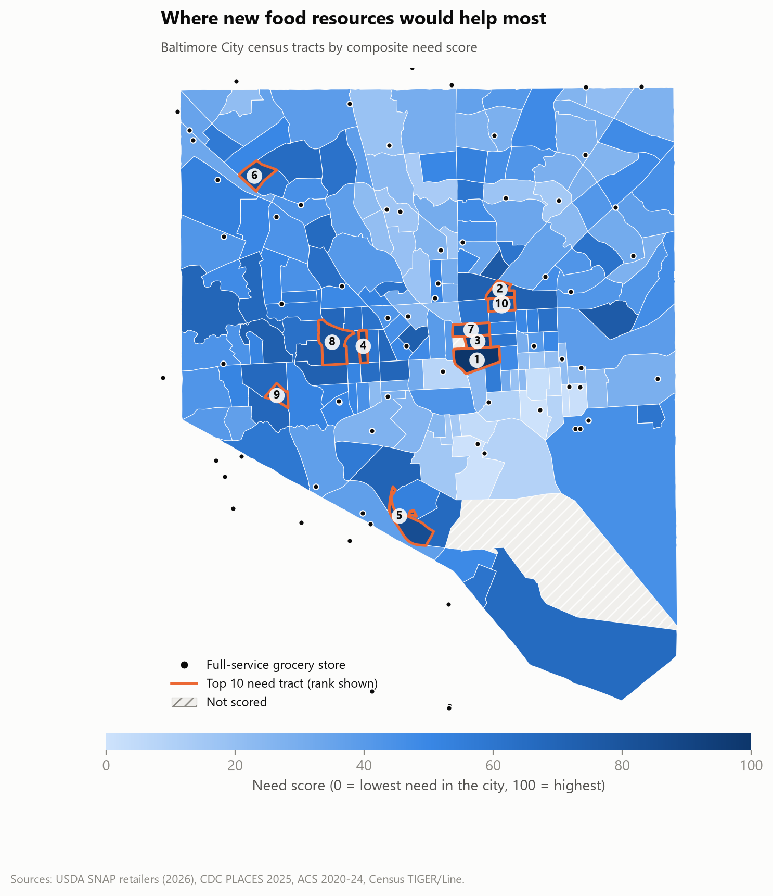
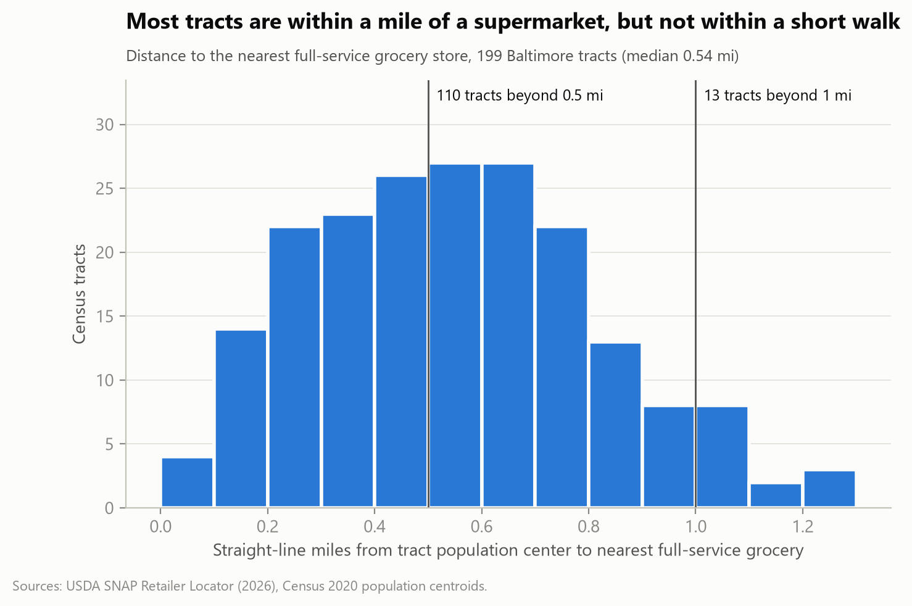
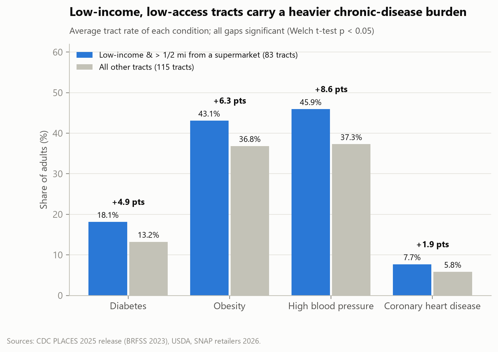
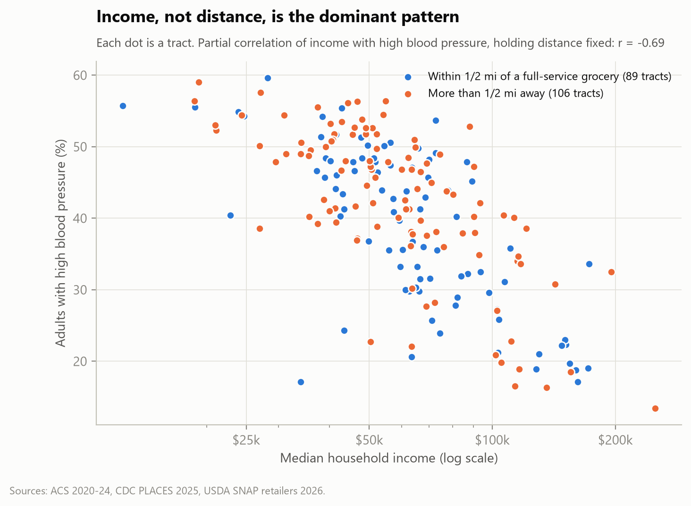
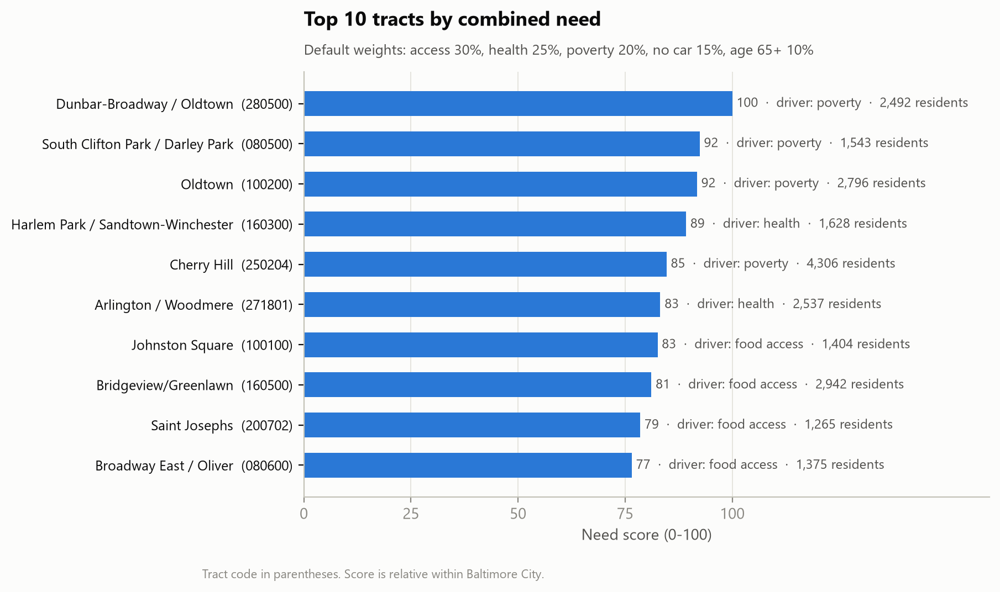
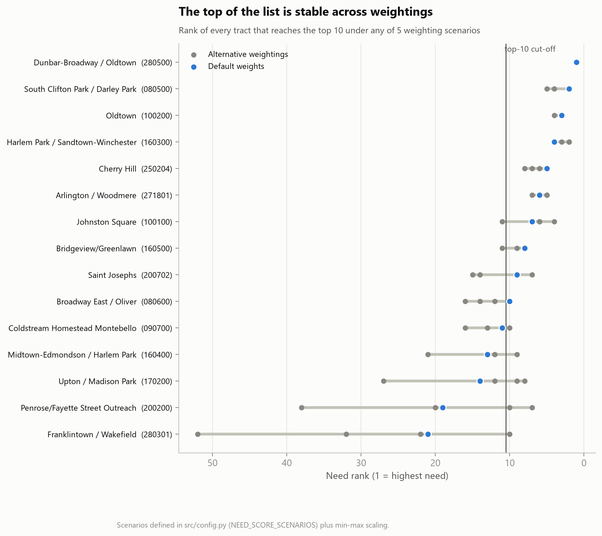
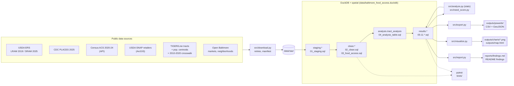

# Baltimore City Food Access and Health Gap Analysis

Which Baltimore neighborhoods have poor access to healthy food, how does that relate to
diet-related disease, income and car ownership, and where would new food resources help
the most people?

This project builds a reproducible local data pipeline (Python, DuckDB with the spatial
extension, SQL) that joins federal and city open data for every census tract in Baltimore
City, answers those questions with SQL and statistics, ranks tracts with a configurable need
score, and produces a findings report, charts, an interactive map and Power BI-ready data.



## Key findings

<!-- KEY-FINDINGS:START -->
_This section is generated by `python -m src.report`; numbers come from the pipeline._

| Headline | Value |
|---|---|
| Residents in low-income tracts > 1/2 mi from a full-service grocery (2026) | 244,920 (43% of the city) |
| Car-free households in tracts > 1/2 mi from a full-service grocery | 37,681 |
| Diabetes rate, low-income low-access tracts vs. others | 18.1% vs 13.2% |
| High blood pressure rate, low-income low-access tracts vs. others | 45.9% vs 37.3% |
| Share of the distance-health link explained away by income | 44-68% |

**1. About 43% of Baltimore residents live in a low-income tract more than half a mile from a full-service grocery store.** That is 244,920 people in 84 of 199 tracts, using 2026 store locations. At the 1-mile standard USDA uses for urban areas, 12 tracts (31,150 residents) qualify. The city has 49 full-service grocery stores; the median tract's population center is 0.54 miles from the nearest one.

**2. Car-free households bear the access gap.** 37,681 households without a vehicle live in tracts more than half a mile from a full-service grocery (4,499 in tracts more than a mile away). 26 tracts are both more than half a mile away and have at least 40% of households without a car, home to 14,900 car-free households.

**3. Low-income, low-access tracts have markedly higher rates of diet-related disease.** Compared with other tracts, adults there have higher rates of diabetes (18.1% vs 13.2%), obesity (43.1% vs 36.8%), high blood pressure (45.9% vs 37.3%) and coronary heart disease (7.7% vs 5.8%) - every gap statistically significant.

**4. Income, not distance, explains most of that gap.** Accounting for median household income shrinks the link between distance and health by 44-68%; income alone explains 48%-61% of the variation in disease rates between tracts. After income, distance remains a statistically significant correlate of high blood pressure and coronary heart disease (for high blood pressure, +5.2 points per mile, 95% CI +0.8 to +9.5). Once the share of residents aged 65+ is also accounted for, none of these associations remains significant at p < 0.05. This is correlation, not causation.

**5. A short, stable priority list.** The ten highest-need tracts, led by Dunbar-Broadway / Oldtown, South Clifton Park / Darley Park and Oldtown, are home to 22,288 residents and 5,753 car-free households. 6 of them stay in the top 10 under all 5 weighting scenarios tested. The map has also shifted since USDA's 2019 data: 23 tracts (51,468 residents) are low-income and low-access now but were not flagged then, while 30 flagged in 2019 no longer meet the 2026 test.

<!-- KEY-FINDINGS:END -->

Full write-up: [reports/findings.md](reports/findings.md) · detailed statistics:
[reports/analysis_results.md](reports/analysis_results.md) · need score:
[reports/need_score.md](reports/need_score.md) · interactive map: `outputs/map.html`
(open in a browser).

| | |
|---|---|
|  |  |
|  |  |



## The problem

"Food deserts" are usually defined by USDA as low-income tracts where many residents live
far from a supermarket. In a dense city like Baltimore, distance alone is a weak signal:
almost everyone is near *some* store, but often only corner stores. Many households
also have no car. This project asks how far residents really are from a full-service grocery
store, who is most affected, and whether access still matters for health once income is
taken into account.

## Data sources

| # | Dataset | Publisher | Version used | Tract vintage |
|---|---------|-----------|--------------|---------------|
| 1 | Food Access Research Atlas - Large Retailer Access Map (LRAM, formerly FARA) | USDA ERS | 2019 data (published 2021) | 2010 -> crosswalked to 2020 |
| 2 | Food Access Research Atlas - SNAP-authorized Retailer Access Map (SRAM) | USDA ERS | 2025 data (published July 2026) | 2020 |
| 3 | PLACES: Local Data for Better Health, census tracts | CDC | 2025 release (BRFSS 2023) | 2020 |
| 4 | American Community Survey 5-year estimates (Census API) | U.S. Census Bureau | 2020-2024 | 2020 |
| 5 | SNAP Retailer Locator (ArcGIS feature service) | USDA FNA (formerly FNS) | live, pulled at run time | points |
| 6 | TIGER/Line census tracts | U.S. Census Bureau | 2024 | 2020 |
| 7 | 2020 Centers of Population by tract | U.S. Census Bureau | 2020 Census | 2020 |
| 8 | 2020-to-2010 tract relationship file | U.S. Census Bureau | 2020 | both |
| 9-11 | Farmers markets, city grocery list, neighborhood boundaries | City of Baltimore (Open Baltimore / CityView) | 2023 / 2023 / current | points, polygons |

Row counts, key columns and known limitations for each file are in
[reports/data_sources.md](reports/data_sources.md) (generated from the downloaded files).
No food pantry dataset with a working public endpoint was found; see Limitations.

## Architecture



## How to run

Requires Python 3.11+ (developed on 3.13) and a free
[Census API key](https://api.census.gov/data/key_signup.html).

```powershell
python -m venv .venv
.\.venv\Scripts\Activate.ps1          # macOS/Linux: source .venv/bin/activate
pip install -r requirements.txt
copy .env.example .env                 # then paste your key after CENSUS_API_KEY=
python run_pipeline.py                 # download -> load -> analyze -> score -> export -> visualize -> report -> test
```

Run single steps with `python run_pipeline.py load test`, or a single source with
`python -m src.download --only acs`. Raw downloads are skipped if already present
(`--force` to refresh). The whole rebuild takes under a minute after the first download.

| Step | Module | Output |
|------|--------|--------|
| download | `src/download.py` | `data/raw/` + `manifest.json` |
| inventory | `src/inventory.py` | `reports/data_sources.md` |
| load | `src/load.py` + `sql/01-04` | DuckDB database, `data/processed/` |
| analyze | `src/analyze.py` + `sql/05-09` | `results.*`, `reports/analysis_results.md` |
| score | `src/need_score.py` + `sql/10` | need score, `reports/need_score.md` |
| export | `src/export.py` | `outputs/powerbi/` |
| visualize | `src/visualize.py` | `outputs/charts/`, `outputs/map.html` |
| report | `src/report.py` + `sql/11` | `reports/findings.md`, README findings, `reports/resume_numbers.md` |
| test | `tests/` | data-quality and consistency checks |

## Methodology

- **Geography.** All data are standardized to Baltimore City's 2020-vintage census tracts
  (11-character GEOIDs, stored as text). The TIGER/Line tract list is the master table; every
  other source is LEFT JOINed to it so no tract can be dropped.
- **Crosswalk.** USDA's supermarket-based 2019 data use 2010 tracts. They are converted to
  2020 tracts with the Census relationship file using land-area weights (flags become
  land-weighted shares, with a 2020 tract flagged when at least 50% of its land was flagged;
  counts are split by each 2010 tract's land share). Tests confirm the weights sum to 1 and
  totals are preserved. Details: [reports/methodology.md](reports/methodology.md).
- **Cleaning.** Census sentinel codes become NULL, suppressed values are flagged, and every
  filter or value change is written to a data-quality log
  (`data/processed/data_quality_log.csv`).
- **Food access.** Full-service grocery stores = USDA SNAP *Supermarket* or *Super Store*,
  excluding warehouse clubs and gas stations. Distance is measured in Maryland State Plane
  (EPSG:2248) from each tract's 2020 population-weighted centroid to the nearest such store
  anywhere in Maryland, so stores across the city line count.
- **Low income.** USDA's tract low-income flag (poverty >= 20% or median family income <= 80%
  of the area median), from the 2025 SRAM release.
- **Health comparison.** CDC PLACES crude prevalence; Welch's t-tests with 95% confidence
  intervals.
- **Income adjustment.** OLS regressions of each health rate on distance and log median
  income (and age 65+ as a robustness check) with HC3 robust standard errors, plus partial
  correlations.
- **Need score.** Five components (distance, health burden, poverty, no car, age 65+) are
  standardized (z-scores clipped at +/-3) and combined with weights set in one place,
  `src/config.py` (`NEED_SCORE_WEIGHTS`, rationale in the comments). A sensitivity check
  re-ranks tracts under alternative weightings and min-max scaling.

## Power BI

`outputs/powerbi/` holds a tract fact table, a store dimension, summary metrics, need-score
sensitivity ranks and tract boundaries (GeoJSON). Suggested pages:

1. **Overview** - KPI cards (residents, low-income/low-access residents, car-free households
   far from a grocery), need-score map with store points.
2. **Food access** - distance distribution, tract table sorted by distance, store map by
   category.
3. **Health gap** - clustered columns of disease rates for low-access vs. other tracts; income
   vs. blood-pressure scatter.
4. **Priority neighborhoods** - top 10 by need score, stacked component contributions,
   sensitivity matrix, tract tooltip page.

Step-by-step loading instructions, relationships and DAX measures:
[reports/powerbi_guide.md](reports/powerbi_guide.md).

## Limitations

- **Correlation, not causation.** Cross-sectional, tract-level data; results describe tracts,
  not individuals.
- **Modeled health data.** CDC PLACES estimates are small-area model outputs partly predicted
  from demographics, which builds in some correlation with income.
- **Straight-line distance.** Real walking and transit routes are longer; one centroid per
  tract hides variation within tracts.
- **Store data.** Only SNAP-authorized stores are included; USDA store types are imperfect
  (several misclassifications were corrected and logged); price, quality and hours aren't
  measured. Food pantries are not included (no reliable public endpoint was found).
- **Vintages.** USDA's 2019 supermarket flags are older and were converted by land area; ACS
  values are 2020-2024 averages with margins of error; Census caps median income at $250,000+.
- **Relative score.** The need score ranks tracts within Baltimore only, and its weights are a
  judgment call (hence the sensitivity check).

## Project structure

```
data/raw/            downloaded files (gitignored)
data/processed/      cleaned tables, results CSVs, data-quality log
sql/                 01-04 build the database, 05-11 answer the questions
src/                 download, load, analyze, need_score, export, visualize, report
tests/               pytest data-quality and consistency tests
outputs/charts/      PNG charts
outputs/powerbi/     Power BI-ready CSVs + GeoJSON
outputs/map.html     interactive Folium map
reports/             findings, analysis results, need score, methodology, data inventory
run_pipeline.py      one-command rebuild
```
